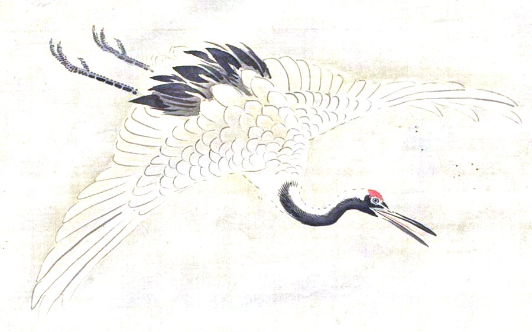

<p align="center">
  
</p>

<h1 align="center">Rayyan Syed · Portfolio v3</h1>

<p align="center">
  <b>Walk quietly. Leave a mark.</b><br>
  A portfolio that opens like a hanging scroll, follows your local sky, and lets a Hokusai wave carry you between sections.
</p>

<p align="center">
  
  
  
  
  
</p>

---

## The idea

Most portfolios list skills. This one tries to feel like somewhere. It is built on **Daybreak**, my own design system, in its dawn theme: warm paper, deep sea indigo, one red sun. The Japanese influence comes from real Edo period art from The Met's public domain collection, brought to life in code.

## What happens when you visit

| Moment | What you see | Where it lives |
| --- | --- | --- |
| **Opening** | A small hanging scroll in the middle of the page. Scroll, and it unrolls into the full hero. | `ScrollExpandHero.jsx` |
| **The sky** | Hokusai's *Great Wave*, animated in WebGL. The sky follows your clock: dawn, day, dusk or a starry night. Pick **Storm** for rain, lightning and (if you turn it on) thunder. The sun rises as you scroll and the boats bob. | `GreatWaveHero.jsx`, `sky.js` |
| **Moving around** | Click a section and a transition carries you there: a crashing wave, a storm of sakura petals, falling maple leaves, sumi ink or a lightning flash. | `Transitions.jsx` |
| **The paper** | A crane glides across the page as you scroll. A cherry branch sways and lets its petals go. | `Sections.jsx` |
| **Work** | An ink painted mountain valley that follows the sky (rain and lightning in a storm, birds by day), with every project in one sideways rail of tilting cards. Each opens a spec sheet. | `Sections.jsx`, `MountainSky.jsx` |
| **A quiet place** | A small 3D island: torii gate, stone lantern, a cherry tree shedding petals, calm water, lit by the same sky. Drag to look around. | `Shrine3D.jsx` |
| **Shortcuts** | `Ctrl K` opens a command menu: jump anywhere, copy my email, change the sky, pick a transition. | `CommandMenu.jsx` |

Everything respects a **Motion** switch in the nav, works at phone width, and keeps Resume and Email one click away.

## Run it

```bash
npm install
npm run dev
```

Then open the address Vite prints (by default `http://localhost:5190`).

## How it is put together

```
src/
  App.jsx                 page order
  sky.js                  time of day palettes for the hero
  prefs.jsx               motion, sky, transition and sound settings
  audio.js                storm sound, synthesized with WebAudio
  data.js                 projects and experience
  components/
    ScrollExpandHero.jsx  hanging scroll opening
    GreatWaveHero.jsx     WebGL Great Wave, sky, rain, lightning, boats
    Transitions.jsx       the five screen transitions
    Shrine3D.jsx          three.js island
    Sections.jsx          statement, work, experience, notes, contact
    Nav.jsx, CommandMenu.jsx, Ambient.jsx
public/
  great-wave.jpg          Hokusai, resized for the web
  art/                    crane and cherry blossom, silk lifted to ink on white
```

A few decisions worth knowing:

* **Real art over drawn art.** The paintings are the actual prints and scrolls. Their aged silk is lifted out ahead of time so only the ink sits on the page.
* **No scroll hijacking.** The opening uses a sticky section, so trackpads, keyboards and phones all scroll normally.
* **three.js loads late.** The 3D chunk is only fetched when you get close to the island, so the first screen stays fast.
* **A real model can drop in.** Put a model at `public/models/scene.glb` and it replaces the placeholder island.

## What is next

* A short scroll story about me before the main page, designed for phones first
* Real screenshots for each project

## Credits

* Katsushika Hokusai, *Under the Wave off Kanagawa*, ca. 1830 to 32. The Met, object 45434, public domain.
* Kano Chikanobu, *Crane, Tortoise, Pine, and Bamboo under a Rising Sun*. The Met, object 45728, public domain.
* Matsumura Goshun, *Cherry Blossoms*. The Met, object 49049, public domain.
* Story chapters and section backdrops (`public/art/story`), all public domain or CC0 via Wikimedia Commons:
  * Kawase Hasui, *Evening Snow at Terashima Village* (1920), *Shin Ōhashi* (1926) and *Ioridani Pass* (1923). Public domain in Japan (artist died 1957) and in the US (published before 1931).
  * Katsushika Hokusai, *Fine Wind, Clear Morning* (Red Fuji).
  * Utagawa Hiroshige, *The Whirlpools of Awa* (The Met DP146864), *Fireworks at Ryōgoku* (Musée Guimet EO1841), *Evening Cherry Blossoms at Gotenyama* (The Met DP123249, cropped to the sky and blossoms) and *Plum Garden at Kameido* (Rijksmuseum RP-P-1956-743, cropped to the red sky and branches).
* `src/components/reactbits/Stack` from [React Bits](https://reactbits.dev) by David Haz, MIT + Commons Clause. Free to use here; the component itself may not be resold.
* The opening is adapted from 21st.dev's scroll expansion hero.
* Fonts: Shippori Mincho B1, Yuji Boku, Zen Kaku Gothic New and Geist Mono, SIL Open Font License 1.1.

---

<p align="center">Built by <a href="https://github.com/Rayyan2235">Rayyan Syed</a> · <a href="https://linkedin.com/in/RayyanSyed">LinkedIn</a></p>
